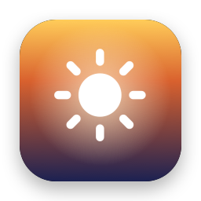
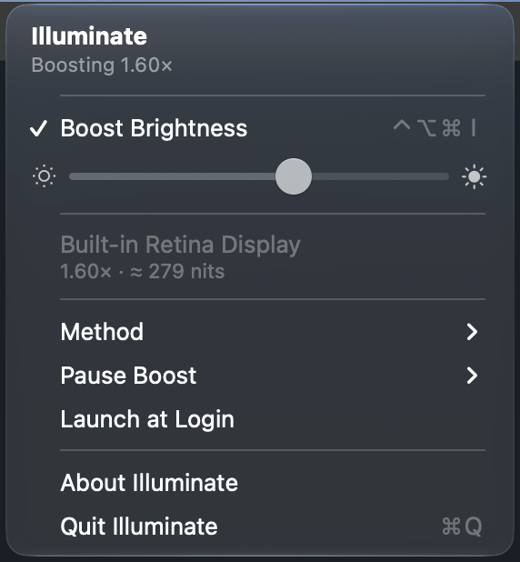
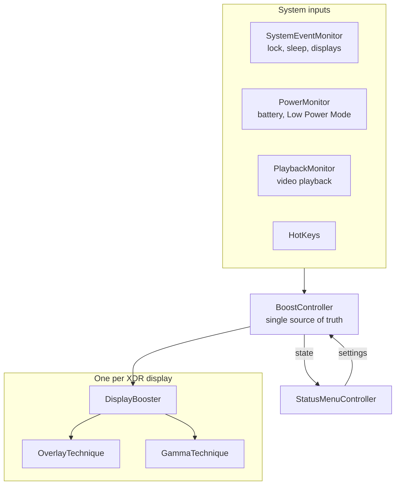
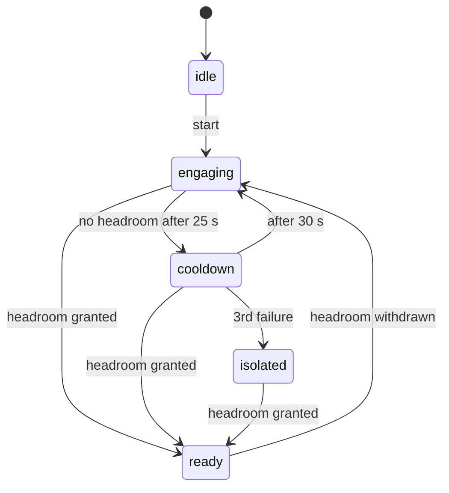

<div align="center">



# Illuminate

**Unlock the extra brightness of your XDR display for everyday content.**

A macOS menu-bar app that lifts SDR content into the display's EDR headroom, up to 2× brighter, built on public macOS APIs.

[](https://github.com/fackelmeyer/illuminate/actions/workflows/ci.yml)


[](LICENSE)



</div>

## Why

On a MacBook Pro with a Liquid Retina XDR panel, macOS caps desktop content at 500–600 nit, although the panel sustains 1000 nit full-screen. The extra range is reserved for HDR video. Illuminate asks WindowServer for that EDR headroom and lifts ordinary SDR content into it, by up to 2× of the current SDR white.

## Highlights

- **Follows your brightness slider.** Full boost means 2× the current SDR white, capped at 60 % of the live headroom so a 1600-nit panel stays near its 1000-nit full-screen limit.
- **Two methods.** A multiply overlay that leaves no system state behind, or a gamma-table method that keeps colours faithful.
- **Per display.** Each XDR display is engaged on its own; one that refuses EDR never affects another.
- **Pauses itself.** For the screen saver, lock screen, user switching, sleep, low battery, Low Power Mode and video playback.
- **Crash-safe.** The overlay disappears with the process; boosted gamma tables are restored on exit, on signals and after a crash.
- **Keyboard first.** Global shortcuts without Accessibility permission.

## Getting started

**Requirements**

- macOS 14 or later to run; Xcode 27 or later (Swift 6.4) to build.
- A display that reports `maximumPotentialExtendedDynamicRangeColorComponentValue ≥ 2`: MacBook Pro 14"/16" (M1 Pro or later), Pro Display XDR, Studio Display XDR. Other HDR monitors may work but have not been tested.

**Install**

```sh
scripts/dmg.sh             # builds build/Illuminate-<version>.dmg
```

Open the disk image, drag **Illuminate** onto **Applications**, eject the image, and start Illuminate from the Applications folder. To start it automatically, choose **Launch at Login** in its menu. Illuminate then appears under System Settings › General › Login Items, where you can also switch it off.

> [!NOTE]
> The build is ad-hoc signed, which is enough on the Mac that built it; other Macs block it through Gatekeeper. To distribute it, sign with a Developer ID (`SIGN_IDENTITY="Developer ID Application: …" scripts/dmg.sh`) and notarize the disk image with `xcrun notarytool`.

**Launch at Login** is greyed out while Illuminate runs from the disk image, because macOS would record a path that disappears when you eject the image.

## Usage

| Shortcut | Action |
|---|---|
| <kbd>⌃</kbd> <kbd>⌥</kbd> <kbd>⌘</kbd> <kbd>I</kbd> | Toggle the boost |
| <kbd>⌃</kbd> <kbd>⌥</kbd> <kbd>⌘</kbd> <kbd>↑</kbd> / <kbd>↓</kbd> | Raise or lower the boost by 10 % |
| Menu bar ☀︎ | Slider, method, pause rules, Launch at Login |

> [!CAUTION]
> Higher brightness costs battery and adds some LED wear. macOS's own thermal limiter stays in charge, and Dark Mode keeps the panel cooler during long sessions.

## How it works

Illuminate has two techniques; switch between them under **Method**.

**Overlay (default).** A borderless, click-through window covers each display at shielding level. Its only content is a `CAMetalLayer` with `wantsExtendedDynamicRangeContent = true`, an `.rgba16Float` pixel format in extended linear sRGB, and `compositingFilter = "multiply"`. The layer is cleared to a 1×1 drawable of value *k* > 1, so WindowServer multiplies everything beneath it by *k*.

**Gamma table.** A 1×1 EDR trigger window keeps headroom granted while Illuminate scales the display's *captured* transfer table with `CGSetDisplayTransferByTable`, so calibration is preserved and colours stay faithful.

| | Overlay | Gamma table |
|---|---|---|
| HDR video | multiplied, not clipped | clips |
| State left behind if the app dies | none | boosted table, repaired at next launch |
| Other gamma apps (f.lux) | unaffected | conflict |
| M5 Pro / M5 Max | works | disabled: macOS ignores gamma tables (FB22273730, [forum thread](https://developer.apple.com/forums/thread/819331)) |

### Architecture



The rules behind gain, engagement, pausing and power live in `IlluminateCore`, which has no AppKit dependency and is covered by Swift Testing.

### Engagement state machine

Each display waits for headroom before any gain is applied, and backs off if macOS refuses it:



Any state returns to `idle` when the boost stops. Timeouts use a monotonic clock, so changing the system time cannot stretch or skip them.

### Robustness

- **Pausing:** Pause reasons form a *set*, so the boost resumes only when every reason has cleared, not when the screen saver stops while the screen is still locked.
- **Power:** By default the boost pauses on battery below 20 % and in Low Power Mode. Both rules can be changed in the menu.
- **Video:** When a player holds a display-sleep power assertion, the gain drops to 1. The overlay stays up so headroom isn't lost.
- **Gamma safety:**
  - A drift watchdog runs every 5 s and accounts for readback clamping at 1.0. When macOS or another app replaces the table, Illuminate boosts the new table instead of reverting it.
  - An all-black ("zero gamma") table is repaired from the last good baseline, without touching other displays.
  - Each display gets its own table back at exit and on SIGTERM, SIGINT, SIGHUP and SIGQUIT. If the previous session crashed, the next launch restores the ColorSync settings.
- **Overlay hygiene:**
  - The overlay presents at 5 fps; otherwise WindowServer promotes the idle window to direct scan-out and drops the filter.
  - The window fades in only after the first frame is on screen, with at most 2 frames in flight.
  - It is re-anchored on every tick and hidden from VoiceOver.

## Engineering notes

- **Logic without AppKit.** Gain, engagement, pausing, power rules, preference decoding and install location live in `IlluminateCore`. A monotonic clock and the system state are passed in, so the tests run the state machines deterministically and in parallel.
- **Thin app shell.** `BoostController` is the single source of truth. Monitors feed it events, and the menu only renders its state, and only while it is open.
- **Concurrency.** The app target is main-actor by default with Approachable Concurrency. The C callbacks (Carbon hotkeys, IOKit power, display reconfiguration) are `nonisolated` and enter the main actor with `MainActor.assumeIsolated`, which traps instead of racing if the assumption ever breaks.
- **Strict compiler settings.** Swift 6 language mode, `ExistentialAny`, `MemberImportVisibility` and `InternalImportsByDefault` in every target, and warnings as errors. `IlluminateCore` also builds with strict memory safety.
- **CI.** Every push and pull request builds, tests and bundles a universal binary on GitHub's Xcode 27 runner.

## Development

```sh
swift test                      # unit tests for the core logic
scripts/bundle.sh               # builds and ad-hoc signs build/Illuminate.app
open build/Illuminate.app
swift scripts/make-icon.swift   # regenerates Support/AppIcon.icns
```

```
Sources/IlluminateCore/   Pure logic, no AppKit, unit-tested
  BoostCurve              level → gain, headroom and nits caps, nits estimate
  EngagementMachine       per-display EDR engagement state machine
  SuspensionState         set of pause reasons
  GammaTable              scale / clamp / compare / baseline repair
  DisplayProfile          eligibility and known panel peaks
  Preferences             lenient Codable settings, PowerStatus rules
  PlatformQuirks          M5 Pro/Max gamma bug, playback heuristic
Sources/Illuminate/       The app (main actor by default)
  BoostController         single source of truth; owns one DisplayBooster per display
  Display/                EDRWindow (Metal surface), techniques, gamma controller
  System/                 system events, power, playback, Carbon hotkeys
  UI/                     status menu, login item
Tests/IlluminateCoreTests Swift Testing
```

<details>
<summary><strong>Manual test checklist (per release)</strong></summary>

Run each of these with the boost on for at least 10 minutes:

- Space switch
- Mission Control
- Full-screen video, both SDR and HDR
- Sleep and wake
- Lock and unlock
- Screen saver
- Lid close and open
- Plugging in an external display
- Switching Method back and forth quickly (each switch re-creates the Metal windows)

Repeat the run on M1/M2 (500 nit), M3 (600 nit), M4/M5 (1000 nit outdoor) and M5 Pro/Max (gamma disabled).

</details>

## Known limitations

- **Screenshots and screen recordings include the boost.** The multiplied pixels clip to SDR white. Excluding the overlay with `sharingType = .none` would turn captures black, because the multiply then applies against an empty window.
- **Full-screen video and some games.** Other XDR tools report that the boost fades after about 10 s in full-screen video on the macOS 27 beta ([BrightIntosh #301](https://github.com/niklasr22/BrightIntosh/issues/301)), and that some games withdraw the headroom while they are in front ([BrightIntosh #309](https://github.com/niklasr22/BrightIntosh/issues/309)). The engagement machine re-requests EDR, but this has not been verified here.
- **Undocumented filter name.** `"multiply"` is an undocumented compositing filter name on a public property.

## Prior art

Other apps that brighten XDR displays beyond the SDR limit:

- [BrightIntosh](https://github.com/niklasr22/BrightIntosh) (open source, GPL-3.0). Its issue tracker documents many of the macOS edge cases listed above.
- [Vivid](https://www.getvivid.app/) (commercial)
- [Lunar](https://lunar.fyi/) (commercial, "XDR Brightness" feature)

## License

[MIT](LICENSE) © 2026 Jonas Fackelmeyer
